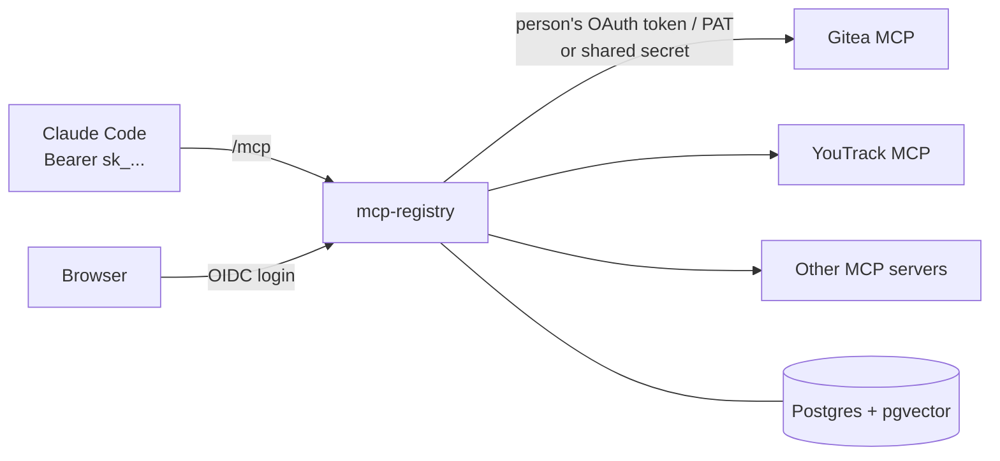

# mcp-registry

A self-hosted MCP gateway: one MCP endpoint for your AI agents (Claude Code and other MCP clients) in front of all the MCP servers your team uses.

Instead of loading hundreds of upstream tools into the agent's context, the gateway exposes four meta-tools. The agent searches for the tool it needs, reads its schema, and calls it through the gateway. Each call is made on behalf of the person: with their own OAuth token or personal access token for that service, or with a shared server secret that never leaves the gateway.

**Who it is for.** Individuals and small teams who run their own services (Gitea, YouTrack, internal tools) inside their own network and want one place to manage MCP access. It is a single container plus Postgres. It is **not** an enterprise product: no multi-tenancy, no HA clustering, no fine-grained RBAC beyond "member / admin / server visible to groups".

## How it works



The agent sees exactly four tools, whatever the catalog contains:

| Tool            | What it does                                                                                  |
| --------------- | --------------------------------------------------------------------------------------------- |
| `list_servers`  | Servers the person may use, and whether they still need to connect an account (with a link).  |
| `search_tools`  | Hybrid search (full-text + vector) over tool descriptions; returns `<server>.<tool>` refs.    |
| `describe_tool` | Full description and `inputSchema` of one tool.                                               |
| `call_tool`     | Calls the upstream tool with the person's credentials; the upstream result is returned as is. |

Search returns an empty list when nothing is relevant enough, rather than padding results with near misses.

## Features

- UI login through any OIDC provider that can put the person's groups or roles into a claim of the ID token or UserInfo; no passwords stored.
- Personal API tokens (`sk_...`) for `/mcp`; the UI shows a ready-to-paste `claude mcp add` command.
- Server catalog: add upstream MCP servers, restrict them to groups, hide individual tools, set per-call timeouts and per-person daily limits.
- Per-user credentials: OAuth 2.0 (Authorization Code + PKCE, automatic refresh) or personal access tokens; or one shared secret per server.
- Secrets encrypted at rest with AES-256-GCM; key rotation without downtime.
- Catalog synchronisation with upstream every 6 hours (configurable) and on demand.
- Local embeddings (`multilingual-e5-small`, baked into the image; no external service, works offline). An OpenAI-compatible embeddings API can be used instead.
- Call log (who, which tool, outcome, duration; never arguments or results), audit log of admin actions.
- Strict CSP web UI (`default-src 'self'`, no inline scripts or styles).

## Quick start (Docker Compose)

Requirements: Docker with Compose, an OIDC provider, and (for anything beyond localhost) a TLS-terminating reverse proxy in front of the gateway.

```sh
git clone https://github.com/ai-pipes/mcp-registry.git && cd mcp-registry
cp .env.example .env
```

Edit `.env`:

```sh
PUBLIC_URL=https://mcp.example.com
TRUST_PROXY=true                       # behind a reverse proxy
POSTGRES_PASSWORD=$(openssl rand -base64 32)
SECRETS_KEY=$(openssl rand -base64 32) # back this up: without it stored secrets are lost
OIDC_ISSUER=https://id.example.com
OIDC_CLIENT_ID=...
OIDC_CLIENT_SECRET=...
```

(Generate the values with `openssl rand -base64 32` and paste them in; `.env` does not run shell commands.)

Start it:

```sh
docker compose up -d --build
curl http://localhost:3000/healthz   # ok
```

Compose runs the app and `pgvector/pgvector:pg17`; Postgres is not published. Migrations run on startup. A prebuilt image is published to `ghcr.io/ai-pipes/mcp-registry` for tagged releases.

### First admin

Put yourself in the admin group of your OIDC provider (`OIDC_ADMIN_GROUP`, default `mcp-admins`) and sign in at `PUBLIC_URL`. Role and groups are taken from the provider on every login.

Without a working provider (emergency access, scripted setups) you can create a person with the CLI inside the container. `<sub>` is the person's subject ID at the provider:

```sh
docker compose exec app node dist/cli.js create-user --sub <sub> --name "Jane" --admin
```

### Connect an agent

In the UI, open **Tokens**, create a token and copy the command it shows. Or from the CLI:

```sh
docker compose exec app node dist/cli.js create-token <sub> --name laptop
```

Then:

```sh
claude mcp add --transport http mcp-registry https://mcp.example.com/mcp \
  --header "Authorization: Bearer sk_..."
```

## Configuration

All settings are environment variables (see `.env.example`). An empty value (`KEY=`) counts as unset.

| Variable                      | Default                       | Meaning                                                                                                                                  |
| ----------------------------- | ----------------------------- | ---------------------------------------------------------------------------------------------------------------------------------------- |
| `PUBLIC_URL`                  | required                      | External URL of the gateway (scheme + host + port). Used for OIDC/OAuth redirect URIs, the `claude mcp add` command and `Origin` checks. |
| `DATABASE_URL`                | required (Compose sets it)    | Postgres connection string. Compose defaults to `postgres://mcp@db:5432/mcp` with `POSTGRES_PASSWORD`.                                   |
| `POSTGRES_PASSWORD`           | required by Compose           | Password of the bundled Postgres. Set it before the first start; it is stored in the volume afterwards.                                  |
| `PORT`                        | `3000`                        | Listening port (with Compose: the host port; the container always listens on 3000).                                                      |
| `ALLOWED_HOSTS`               | empty                         | Extra accepted `Host` values for `/mcp`, comma-separated. The `PUBLIC_URL` host, `localhost` and `127.0.0.1` are always accepted.        |
| `TRUST_PROXY`                 | `false`                       | Take the client IP from `X-Forwarded-For`. Enable only behind a reverse proxy.                                                           |
| `TRUST_PROXY_HOPS`            | `1`                           | Number of trusted proxies in front of the gateway (1-5).                                                                                 |
| `COOKIE_SECURE`               | `true`                        | `Secure` flag on the session cookie. Works with HTTPS and with `http://localhost`.                                                       |
| `SECRETS_KEY`                 | required                      | AES-256-GCM key, base64 of exactly 32 bytes (`openssl rand -base64 32`). Encrypts server secrets and people's tokens.                    |
| `SECRETS_KEY_OLD`             | unset                         | Previous key, only during key rotation. Must differ from `SECRETS_KEY`.                                                                  |
| `OIDC_ISSUER`                 | required                      | Issuer URL of the OIDC provider. Discovery happens on the first login, not at startup.                                                   |
| `OIDC_CLIENT_ID`              | required                      | Client ID registered for the gateway.                                                                                                    |
| `OIDC_CLIENT_SECRET`          | required                      | Client secret registered for the gateway.                                                                                                |
| `OIDC_LOGIN_GROUP`            | `mcp-users`                   | Members of this group may sign in.                                                                                                       |
| `OIDC_ADMIN_GROUP`            | `mcp-admins`                  | Members of this group may sign in and are admins.                                                                                        |
| `OIDC_SCOPES`                 | `openid profile email groups` | Scopes of the login request, space- or comma-separated; must include `openid`.                                                           |
| `OIDC_GROUPS_CLAIM`           | `groups`                      | Claim with the person's groups: a list of names, or an object whose keys are the names.                                                  |
| `SYNC_INTERVAL_HOURS`         | `6`                           | Catalog synchronisation period, hours (1-8760).                                                                                          |
| `CALL_LOG_RETENTION_DAYS`     | `90`                          | How long call log entries are kept.                                                                                                      |
| `UPSTREAM_MAX_RESPONSE_BYTES` | `20971520` (20 MiB)           | Larger upstream responses are refused (memory protection).                                                                               |
| `MCP_MAX_BODY_BYTES`          | `10485760` (10 MiB)           | Request body limit of `/mcp` (tool arguments may carry base64 files). The rest of the HTTP API is limited to 1 MiB.                      |
| `EMBEDDER`                    | `local`                       | `local` (bundled model) or `openai-compatible` (`POST <EMBEDDER_URL>/embeddings`).                                                       |
| `EMBEDDER_URL`                | unset                         | Base URL of the embeddings API, only for `openai-compatible`.                                                                            |
| `EMBEDDER_MODEL`              | unset                         | Model name for `openai-compatible`. Must produce 384-dimensional vectors.                                                                |
| `MODEL_DIR`                   | `/app/models`                 | Directory of the local model. The image already contains it.                                                                             |
| `SEARCH_MIN_SIMILARITY`       | `0.83`                        | Cosine-similarity floor (0-1) for vector search candidates.                                                                              |
| `LOG_LEVEL`                   | `info`                        | `fatal`, `error`, `warn`, `info`, `debug`, `trace` or `silent`.                                                                          |

## OIDC setup

Any OIDC provider works if it can put the person's groups (or roles) into one claim of the ID token or the UserInfo response: a flat list of names, or an object whose keys are the names. The claim name is `OIDC_GROUPS_CLAIM` (default `groups`), the requested scopes are `OIDC_SCOPES` (default `openid profile email groups`).

1. Create two groups: the login group (`mcp-users`) and the admin group (`mcp-admins`). Membership in either lets a person in; the admin group also makes them an admin.
2. Create a confidential OIDC client:
   - redirect URI: `https://<host>/api/auth/callback`;
   - PKCE: allowed (the gateway always sends S256);
   - make sure the groups claim is emitted (see the table below).
3. Put the issuer, client ID and client secret into `OIDC_ISSUER`, `OIDC_CLIENT_ID`, `OIDC_CLIENT_SECRET`, and set `OIDC_SCOPES` / `OIDC_GROUPS_CLAIM` if your provider needs it.

| Provider                               | Settings                                                                                                                                                                 |
| -------------------------------------- | ------------------------------------------------------------------------------------------------------------------------------------------------------------------------ |
| Pocket ID, Authentik, Authelia, Kanidm | defaults                                                                                                                                                                 |
| Keycloak                               | defaults; add a client scope `groups` with a Group Membership mapper (token claim name `groups`, "Full group path" off) and assign it to the client                      |
| Zitadel                                | `OIDC_SCOPES=openid profile email urn:zitadel:iam:org:projects:roles`, `OIDC_GROUPS_CLAIM=urn:zitadel:iam:org:project:roles`; use project roles named like the groups    |
| Microsoft Entra ID                     | `OIDC_SCOPES=openid profile email`, `OIDC_GROUPS_CLAIM=roles`; define app roles named like the groups and assign them (the `groups` claim carries object IDs, not names) |
| Auth0                                  | `OIDC_SCOPES=openid profile email`, `OIDC_GROUPS_CLAIM=https://<your-namespace>/groups`; add the claim to the ID token with a post-login Action                          |

These are starting points, not tested recipes; check the claims your provider actually issues (for example on its token preview page) if login answers `/?loginError=not_allowed`.

Check the issuer with `curl -s https://id.example.com/.well-known/openid-configuration`. If login redirects to `/?loginError=idp_unavailable`, the gateway cannot reach `OIDC_ISSUER`; `/mcp` and existing tokens keep working.

Disabling a person in the UI revokes all their sessions and tokens.

## Adding upstream servers

Upstreams must speak **Streamable HTTP**. Each server has a `slug` (kebab-case, the prefix of its tool refs, cannot be changed later), a URL, an auth mode, access (everyone or a list of groups), a call timeout and an optional daily limit per person.

| Auth mode       | Credentials                                                                                                       |
| --------------- | ----------------------------------------------------------------------------------------------------------------- |
| `none`          | No header is sent.                                                                                                |
| `shared_secret` | One secret for the server, set by an admin, sent by the gateway for everyone.                                     |
| `pat_user`      | Each person stores their own personal access token in **Connections**.                                            |
| `oauth_user`    | Each person connects their account via OAuth 2.0 (Authorization Code + PKCE); tokens are refreshed automatically. |

For all modes except `none` you set a header name and a template containing `{secret}`, e.g. `Authorization` / `Bearer {secret}`. Secrets in the form are write-only.

**Order matters:** add the server, then connect your own account in **Connections**, then press **Sync**. For `oauth_user` and `pat_user` servers the first sync right after creation reports that an admin connection is needed; that is expected. Scheduled syncs use the connection of the last admin who synced the server successfully; if that person loses the admin role, another admin with a connection must press Sync once.

### Gitea (`oauth_user`)

1. Run `gitea-mcp` in HTTP mode, with no global token (each request carries the person's token), reachable from the gateway and not published:

   ```yaml
   gitea-mcp:
     image: docker.gitea.com/gitea-mcp-server
     command: ['/app/gitea-mcp', '-t', 'http', '--port', '8080', '-H', 'https://gitea.example.com']
   ```

2. In Gitea: Site Administration -> Applications -> OAuth2 Applications -> create an app, **Confidential Client** on, redirect URI `https://<host>/api/connections/callback`. Save the client ID and secret.
3. Add the server in the gateway:

   | Field             | Value                                                |
   | ----------------- | ---------------------------------------------------- |
   | URL               | `http://gitea-mcp:8080/mcp`                          |
   | Auth mode         | `oauth_user`                                         |
   | Authorize URL     | `https://gitea.example.com/login/oauth/authorize`    |
   | Token URL         | `https://gitea.example.com/login/oauth/access_token` |
   | Revoke URL        | empty (Gitea has no RFC 7009 endpoint)               |
   | Client ID, secret | from step 2                                          |
   | Scopes            | empty (Gitea then grants the user's full access)     |
   | Header / template | `Authorization` / `Bearer {secret}`                  |

A request with an invalid token to `gitea-mcp` returns HTTP 401; a connection error instead means the containers are not on the same network.

### YouTrack (`oauth_user`)

YouTrack has a built-in MCP endpoint at `/mcp`. OAuth goes through Hub (built into YouTrack at `<youtrack>/hub`, or standalone).

1. Hub -> Services -> New service: redirect URI `https://<host>/api/connections/callback`, set a secret. The service ID is the client ID.
2. Note the ID of the **YouTrack** service in Hub: it is the scope.
3. Add the server:

   | Field                      | Value                                                                                                                 |
   | -------------------------- | --------------------------------------------------------------------------------------------------------------------- |
   | URL                        | `https://youtrack.example.com/mcp`                                                                                    |
   | Auth mode                  | `oauth_user`                                                                                                          |
   | Authorize URL              | `<hub>/api/rest/oauth2/auth`                                                                                          |
   | Token URL                  | `<hub>/api/rest/oauth2/token`                                                                                         |
   | Client ID, secret          | from step 1                                                                                                           |
   | Scopes                     | the YouTrack service ID from step 2                                                                                   |
   | Extra authorize parameters | `access_type=offline` (**required**: without it Hub issues no refresh token and the connection expires after an hour) |
   | Header / template          | `Authorization` / `Bearer {secret}`                                                                                   |

### A server with a shared key (`shared_secret`)

For an MCP server protected by one API key: auth mode `shared_secret`, header e.g. `Authorization` with template `Bearer {secret}` (or `X-API-Key` / `{secret}`), and the key as the server secret. Every permitted person calls it with the same key; the call log still records who called what.

Servers can also be created from a JSON file (`ServerInput` in `packages/contracts/src/servers.ts`); the secret is read from stdin or an environment variable, never from the command line:

```sh
docker compose exec -T app node dist/cli.js create-server --json /path/in/container/server.json \
  --as <admin-sub> --secret-env UPSTREAM_KEY
```

## Operations

### CLI

Inside the container: `node dist/cli.js <command>` (same environment as the server). Exit codes: 0 success, 1 operation failed, 2 bad invocation.

| Command                                                             | Purpose                                                                                                                      |
| ------------------------------------------------------------------- | ---------------------------------------------------------------------------------------------------------------------------- |
| `create-user --sub <sub> --name <name> [--admin]`                   | Create or update a person as a first login would. Idempotent by `sub`; without `--admin` an existing admin becomes a member. |
| `create-token <sub> --name <name>`                                  | Issue an `sk_` token and print the `claude mcp add` command.                                                                 |
| `create-server --json <file> --as <admin-sub> [--secret-env <VAR>]` | Create a server and sync it. The secret comes from `<VAR>` or stdin.                                                         |
| `sync <slug> [--as <admin-sub>]`                                    | Sync a server's tools (without `--as`: as the scheduler).                                                                    |
| `reindex`                                                           | Rebuild the search index (if `search_tools` misses a tool that is in the catalog).                                           |
| `rotate-secrets-key`                                                | Re-encrypt every stored secret from `SECRETS_KEY_OLD` to `SECRETS_KEY`. Safe to repeat.                                      |

### Rotating `SECRETS_KEY`

1. Generate a new key and keep the old one until rotation is done.
2. Set `SECRETS_KEY_OLD=<current key>`, `SECRETS_KEY=<new key>`, restart. Both keys open secrets meanwhile, so calls keep working; a warning is logged on each start.
3. Run `node dist/cli.js rotate-secrets-key`. It reports how many server secrets and connections were re-sealed. Exit code 1 lists records that neither key opens (wrong old key?).
4. Run it again: it should report `0 re-sealed`. Remove `SECRETS_KEY_OLD` and restart.

Back up `SECRETS_KEY` together with the database: a database restored without its key has no usable secrets or connections.

### Things to know

- **OAuth providers must be on HTTPS and on the same registrable domain as the gateway** (e.g. `git.example.com` and `mcp.example.com`). The session cookie is `SameSite=Strict`, so the browser does not send it on the redirect back from a provider on another site, and the connection fails with `error=unauthenticated`.
- **A wrong OAuth client secret** does not break people's connections, but once their access tokens expire every call to that server fails as "unavailable" (`transport_error` in the call log) until the secret is fixed. Nobody has to reconnect. When rotating a client secret, update it in the gateway first, then revoke the old one at the provider.
- **Search threshold.** `SEARCH_MIN_SIMILARITY` (default `0.83`, calibrated for the bundled model) is the floor for vector matches. Lower it (e.g. `0.80`) if the agent misses obvious tools, raise it if it finds unrelated ones. A restart is enough; no reindex. Recalibrate if you switch to another embedding model.
- **Large tool outputs.** Claude Code truncates MCP tool output at about 25k tokens (`MAX_MCP_OUTPUT_TOKENS`); raise it on the client (`MAX_MCP_OUTPUT_TOKENS=100000 claude`) for large results. The gateway's 20 MiB `UPSTREAM_MAX_RESPONSE_BYTES` only protects server memory.
- **Scope.** Streamable HTTP upstreams only (no stdio, no legacy SSE). Tools only: MCP resources and prompts are not proxied.
- Call arguments and results are never logged. Daily limits reset at midnight UTC.

## Development

Requires Node 22, pnpm (version pinned in `package.json`) and Docker (integration tests start Postgres with Testcontainers).

```sh
pnpm install
pnpm verify                  # lint, format, types, architecture rules, knip, unit + integration tests, UI build
bash scripts/smoke.sh        # end-to-end check of the built image: CLI -> MCP search -> describe -> call
bash scripts/e2e-image.sh    # Playwright against the built image (pnpm exec playwright install chromium)
pnpm dev:web                 # UI dev server, proxies /api and /mcp to localhost:3000
```

Architecture, layer rules and conventions: [CONTRIBUTING.md](./CONTRIBUTING.md) and [CLAUDE.md](./CLAUDE.md). Security reports: [SECURITY.md](./SECURITY.md).

## License

[MIT](./LICENSE)
